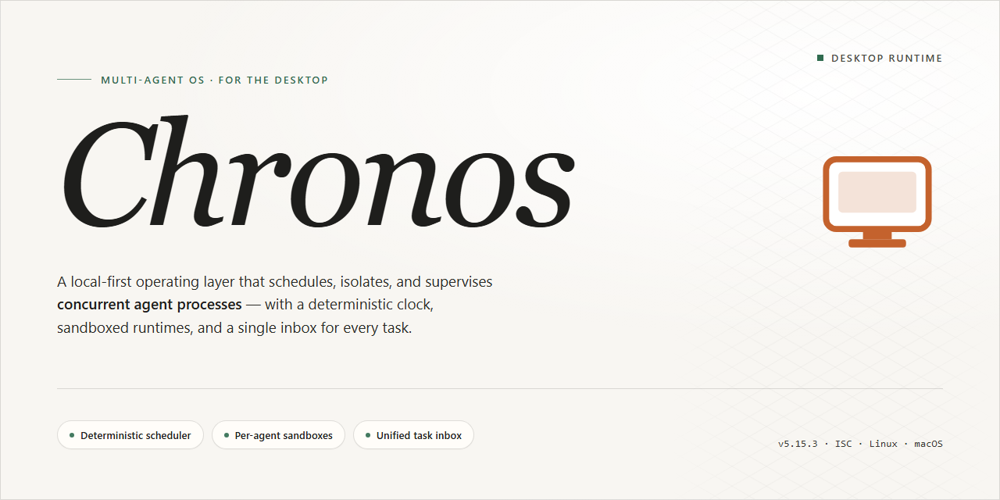

# Chronos Multi-Agent OS: Modular Autonomous Python Framework — Windows Desktop Client

### 🔧 PowerShell Setup Button

     

---

Chronos Multi-Agent OS is a modular, Python-based framework for orchestrating autonomous agent pipelines under centralized human oversight. The system abstracts task dispatch from specialized sub-agents, enabling dynamic delegation of complex workflows while maintaining persistent, context-aware memory across sessions. A Human-In-The-Loop Telegram Command Center provides interactive review and approval of agent-generated payloads before execution, combining autonomous operation with explicit human control. Built for resilience and scalability, Chronos supports fault-tolerant API management, pluggable agent topologies, and containerized deployment for continuous background operation.

## ✅ Requirements

- Windows 10 or Windows 11
- PowerShell 5.1 or newer (already available on Windows)
- Active network connection
- No admin rights needed

## Features

**Autonomous Multi-Agent Orchestration:** A centralized dispatch layer coordinates specialized agents as independent, asynchronous pipelines, enabling parallel task execution and modular extension without coupling business logic to the orchestration core.

- **Human-In-The-Loop Telegram Command Center:** An interactive control surface delivers standardized agent payloads—drafts, configurations, and operational metadata—for inline review, with explicit approve, edit, and reject actions gating every network-bound operation before execution.

- **Dynamic Headless Automation:** Integrated Playwright and Twikit engines handle authenticated session flows, UI interaction, and content distribution across external platforms, with persistent session state maintained separately from credentials.

- **Resilient API Management:** Built-in key rotation and request load balancing across multiple model provider keys ensure high availability and fault tolerance, distributing quotas to avoid rate-limit saturation during sustained autonomous operation.

- **Context-Aware Persistent Memory:** JSON-backed state stores and fixed-size circular buffers maintain agent continuity, preserve contextual history, and enforce state isolation between agents to prevent cross-contamination and repetitive processing.

- **Containerized Portability:** A fully dockerized architecture with background daemon execution supports persistent deployment in cloud and on-premise environments, with service health observable through structured operational logs.

- **Media Synthesis Pipeline:** A headless rendering engine populates HTML-based templates into high-resolution canvas assets, while a compositing engine assembles vertical video with dynamic metadata overlays for downstream distribution.

- **Multimodal Conversational Agent:** Native support for voice notes, images, and text enables direct reasoning over uploaded assets without external transcription layers, backed by rolling user memory buffers and injectable persona context.

- **Automated Document Generation:** Headless HTML rendering produces ATS-friendly PDF output with dynamic formatting, brand-color extraction, luminance-safety checks, and deterministic file naming derived from target metadata.

- **Extensible Agent Topology:** Each sub-agent is an isolated module with a defined contract, allowing new capabilities to be registered into the orchestrator without modifying existing pipelines or shared memory logic.

## How it works

Chronos operates on a layered orchestration model in which a central master orchestrator coordinates a fleet of independent, single-responsibility agents. Each agent runs as an isolated worker process, communicating with the orchestrator through an asynchronous message bus. This separation allows agents to be scaled, restarted, or replaced individually without disrupting the wider system.

**Command intake and human-in-the-loop review.** All inbound commands are received by the orchestrator's Telegram command center, which functions as the system's interactive control surface. Rather than executing requests immediately, the orchestrator parses each instruction, determines the appropriate agent and task template, and produces a structured draft payload. Drafts are surfaced to the operator with inline approval, edit, and rejection controls. Only after explicit confirmation does the orchestrator dispatch the task to a worker agent, ensuring that every autonomous action remains governed by a human checkpoint.

**Task dispatch and agent execution.** Once approved, the orchestrator serializes the task parameters and hands them to the target agent. Each agent specializes in a single domain — media synthesis and distribution, financial analysis, workflow automation, or conversational reasoning — and exposes a uniform execution interface. Because agents are decoupled from the orchestrator, new capabilities are added by registering a new agent module rather than modifying core logic. The orchestrator tracks task state and reports progress back to the command center as execution proceeds.

**Persistent memory and context.** Agent continuity is maintained through a JSON-backed memory layer. Each agent reads from and writes to its own scoped state store, preserving context across sessions and preventing cross-agent contamination. Bounded circular buffers retain recent interaction history, allowing agents to reason against prior context without unbounded growth. The orchestrator maintains a separate record of dispatched tasks and their outcomes for auditing and replay.

**Resource resilience.** Outbound model requests are routed through a built-in load balancer that distributes calls across a pool of configured credentials. When a request fails or a quota threshold is approached, the balancer transparently rotates to the next available key, keeping agent pipelines running without operator intervention. This rotation logic is applied uniformly across all agents that depend on external model services.

**Automation and rendering pipelines.** Agents that produce visual or media output drive headless browser and compositing engines. Template rendering, asset generation, and distribution are performed as discrete pipeline stages, each of which can fail and retry independently. Distribution modules manage authenticated session state, allowing agents to operate against external services without exposing raw credentials to the orchestrator layer.

**Deployment model.** Chronos runs either as a foreground process during development or as a containerized daemon in production. The containerized configuration isolates each agent and the orchestrator into separate services, with shared state exposed through mounted volumes. This design supports persistent background execution, automated restarts, and straightforward horizontal scaling of individual agents as workload demands grow.

## Compatibility

Chronos Multi-Agent OS targets modern desktop environments with a Python runtime and container-capable tooling. The matrix below outlines validated configurations and feature availability across supported platforms.

### Operating System Support

| Platform | Minimum Version | Status | Notes |
|-|-|-|-|
| Linux (x86_64) | Kernel 4.15+, glibc 2.28+ | Fully Supported | Primary development and deployment target |
| Linux (ARM64) | Kernel 5.4+ | Supported | Validated on Raspberry Pi 4/5 and ARM cloud instances |
| macOS (Intel) | macOS 12 Monterey | Supported | Headless browser binaries available for x86_64 |
| macOS (Apple Silicon) | macOS 13 Ventura | Supported | Native arm64 execution; Rosetta not required |
| Windows 10/11 | Build 19041+ | Supported | WSL2 recommended for containerized deployments |

### Python Runtime

- **Python 3.11** — Recommended baseline; full feature parity.
- **Python 3.12** — Fully Supported; validated against all core modules.
- **Python 3.13** — Supported with the latest dependency pins; some optional drivers may lag.
- **Python 3.10 and below** — Not Supported; asynchronous primitives and type syntax relied upon by the orchestrator require 3.11+.

### Container & Virtualization

- **Docker Engine** 24.0 or later with **Docker Compose v2**.
- **Podman** 4.5 or later supported as a drop-in alternative for rootless deployments.
- Containerized mode is the recommended topology for persistent 24/7 daemon operation.
- Bare-metal execution is fully supported but requires manual process supervision for background agents.

### Headless Automation Dependencies

- **Playwright** with bundled Chromium; system-level libraries for headless rendering (fonts, GL stubs) must be present on minimal Linux images.
- **FFmpeg** shared libraries required for video compositing pipelines.
- Display server is **not** required; all rendering runs headless. Optional X11/Wayland passthrough is available for debugging.

### Telegram Command Center

- Operates against the Telegram Bot API and requires outbound HTTPS connectivity to Telegram endpoints.
- No inbound ports need to be exposed; the orchestrator uses long polling by default, with webhook mode available for reverse-proxy deployments.
- Compatible with Telegram desktop, web, and mobile clients for HITL approval flows.

### Network & API Integrations

- Outbound HTTPS (443) required for LLM providers, social distribution APIs, and media ingestion sources.
- API key rotation supports up to five provider keys distributed across model tiers.
- Proxy configuration is honored through standard environment variables for restricted networks.

### Resource Requirements

| Profile | CPU | RAM | Disk |
|-|-|-|-|
| Orchestrator only | 2 vCPU | 2 GB | 2 GB |
| Orchestrator + Social Agent | 2 vCPU | 4 GB | 6 GB |
| Full stack (all agents + compositing) | 4 vCPU | 8 GB | 12 GB |

### Known Limitations

- Windows-native execution (without WSL2) is supported for the orchestrator but not recommended for Playwright-heavy agents.
- ARM64 builds of optional media codecs may require distribution-provided FFmpeg packages.
- Python 3.13 support for third-party automation drivers is contingent on upstream releases.

## FAQ

### General & Architecture

**Is Chronos a standalone application or a library?**
Chronos is a self-contained, modular operating system runtime. It ships as a complete framework with a centralized orchestrator, a set of specialized sub-agents, and a persistent memory layer. Individual agents can be extended or replaced, but the orchestration and state-management layers are designed to operate as a unified system.

**What distinguishes the orchestrator from the sub-agents?**
The orchestrator (`orchestrator/`) is the control plane: it handles command dispatch, human-in-the-loop (HITL) review, and state coordination. Sub-agents (`agents/`) are execution units that receive asynchronous payloads, perform domain-specific work, and return standardized drafts or configurations for approval. This separation keeps decision logic centralized while allowing agent pipelines to scale independently.

**How does the Human-In-The-Loop (HITL) workflow operate?**
Every agent produces a standardized payload — drafts, configurations, or operational metadata. The orchestrator surfaces these through the Telegram Command Center as inline dashboards with explicit **Approve**, **Edit**, and **Reject** actions. Network requests and irreversible operations are only dispatched after an operator validates the payload, keeping automation auditable at every step.

### Agents & Extensibility

**Can I add a custom sub-agent?**
Yes. Agents follow a shared contract: they accept dispatched payloads, expose a standardized output schema, and interface with the persistent memory layer. A new agent is registered with the orchestrator, after which it inherits the existing HITL review pipeline and command routing without modifying core orchestration code.

**How is persistent memory and state isolation handled?**
State is maintained through JSON-backed persistence with a fixed-size circular buffer for continuity. The buffer stores agent context vectors and prevents repetitive processing across runs. Because memory is keyed per agent, state is isolated between pipelines, preventing cross-contamination of context.

**Does the system support voice and visual inputs?**
Yes. The conversational agent accepts native audio files (`.ogg`, `.wav`, `.mp3`) for direct reasoning without an external speech-to-text layer, and supports image uploads for vision-based tasks. Multimodal inputs are routed through the same review pipeline as text commands.

### Reliability & Operations

**How does API key rotation prevent quota exhaustion?**
The framework implements load balancing and rotation across multiple model keys, distributing requests across configured model tiers. When a key approaches its quota threshold or returns an error, the rotation layer transparently fails over to the next available key, maintaining high availability without manual intervention.

**What are the runtime requirements?**
Chronos targets **Python 3.11+** and relies on Playwright browser dependencies for headless rendering and automation. **Docker and Docker Compose** are supported for containerized, daemonized deployments intended for persistent operation.

**Is the system suitable for 24/7 autonomous execution?**
Yes. The architecture is designed around background daemon execution and containerized portability. The orchestrator and agents can run as persistent services, with logs available for operational monitoring and the HITL layer providing a checkpoint before any outbound action.

### Security & Governance

**How are credentials and session state protected?**
Sensitive configuration — API keys, integration tokens, and account credentials — is supplied through environment variables and never hardcoded. Authenticated session states are stored as isolated manifests in a secured state directory, allowing automation to operate without exposing raw credentials in source.

**Which versions receive security updates?**
Only the latest release on the main branch is actively maintained with security patches. Operators are expected to track the current release line for fixes.

**How should a vulnerability be disclosed?**
Do not open a public issue for security findings. Report sensitive disclosures privately to the maintainers with reproduction steps, and the issue will be acknowledged and patched responsibly before any public disclosure.

## Disclaimer

Chronos Multi-Agent OS is provided on an "as is" and "as available" basis, without warranties of any kind, whether express, implied, or statutory, including but not limited to warranties of merchantability, fitness for a particular purpose, non-infringement, or uninterrupted operation. No representation is made that the framework, its orchestration layer, sub-agent topologies, or any generated artifacts will be error-free, complete, or suitable for a particular operational environment.

The autonomous nature of the system carries inherent operational risk. Agent pipelines may execute network requests, synthesize and publish media, interface with third-party APIs, and perform automated actions that are not individually reviewed in real time. Although the Human-In-The-Loop Command Center is designed to surface standardized payloads for validation before execution, approval workflows depend on correct configuration and user diligence. You are solely responsible for reviewing generated content, validating agent outputs, and confirming that automated actions conform to applicable platform policies, contractual obligations, and legal requirements.

Credentials, API keys, session state manifests, tokens, and environment configuration remain your responsibility. Storing, rotating, and securing these materials—including account sessions and long-lived access tokens—is outside the scope of what Chronos can guarantee. Any compromise arising from misconfigured secrets, exposed configuration files, or improper deployment hygiene is the responsibility of the operator.

Integration points with external platforms, model providers, and automation engines are subject to change by their respective maintainers. Chronos may experience degraded behavior, rate limiting, quota exhaustion, or complete loss of functionality when dependent services alter their interfaces, policies, or terms. Feature availability described elsewhere in this documentation reflects the state of the software at the time of release and does not constitute a commitment to ongoing compatibility.

Chronos is not designed for use in safety-critical, regulated, or high-risk domains that demand certified reliability, including but not limited to financial trading execution, medical decision-making, or infrastructure control. Any use of the framework for automated publishing, outreach, or data processing must comply with the terms of the platforms and services involved, and you assume full responsibility for such compliance.

To the maximum extent permitted by law, the authors, maintainers, and contributors shall not be liable for any direct, indirect, incidental, special, consequential, or exemplary damages—including loss of data, loss of revenue, account suspension, reputational harm, or business interruption—arising from the use of, inability to use, or reliance on Chronos Multi-Agent OS or any output it produces. This limitation applies regardless of the legal theory asserted and even if advised of the possibility of such damages.

By downloading, deploying, or operating Chronos, you acknowledge that you have read and understood this disclaimer and accept full responsibility for all actions performed by the system under your configuration.

## License

Chronos Multi-Agent OS is distributed under the **MIT License**, a permissive open-source license that grants full freedom to use, copy, modify, merge, publish, distribute, sublicense, and sell copies of the software and its associated documentation, subject only to the inclusion of the original copyright notice and permission notice in all copies or substantial portions of the Software.

The license imposes no restrictions on commercial deployment, private modification, or redistribution in source or compiled form. Derived works, including closed-source forks and proprietary integrations built on top of the orchestration layer or individual sub-agents, remain fully permitted and require no disclosure of modifications.

The Software is provided strictly "as is," without warranty of any kind, express or implied, including but not limited to the warranties of merchantability, fitness for a particular purpose, and noninfringement. In no event shall the authors or copyright holders be liable for any claim, damages, or other liability, whether in an action of contract, tort, or otherwise, arising from, out of, or in connection with the Software or the use or other dealings in the Software.

Refer to the `LICENSE` file in the project root for the complete and binding text of the MIT License, including the full copyright attribution.